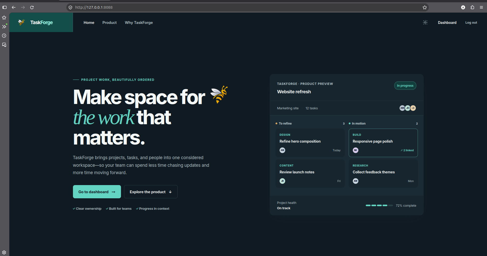
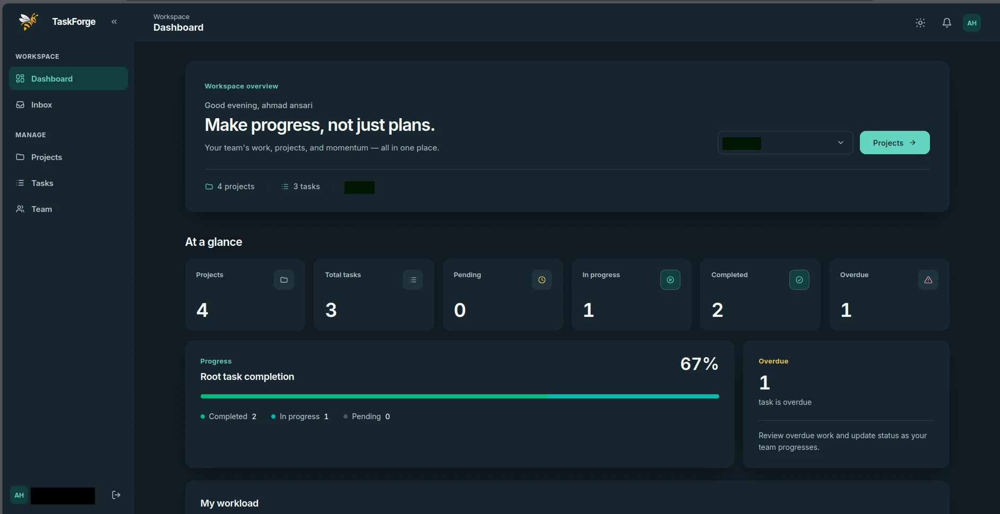
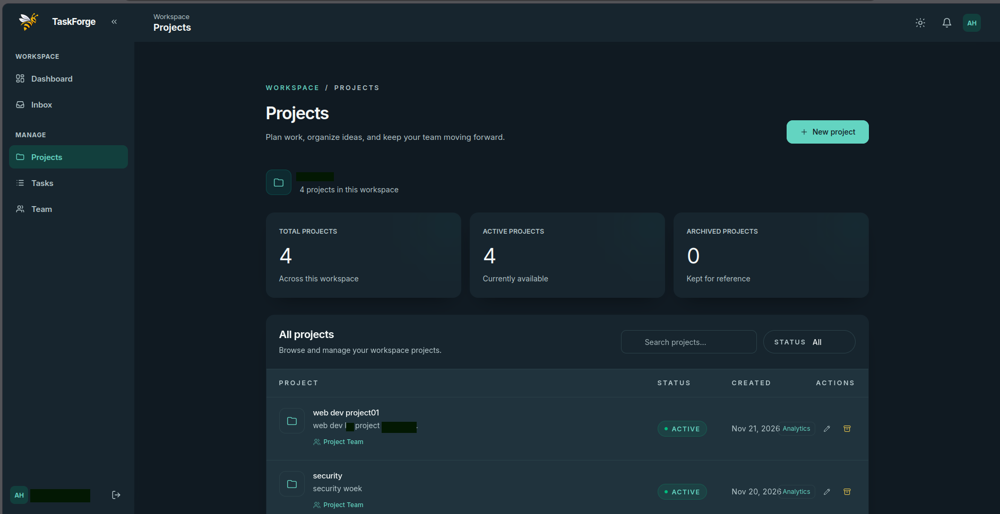
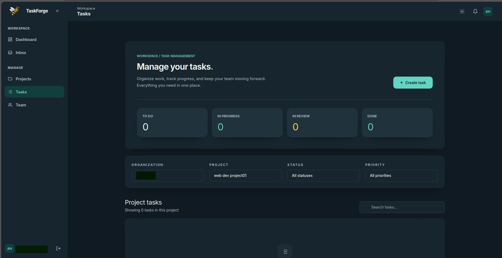
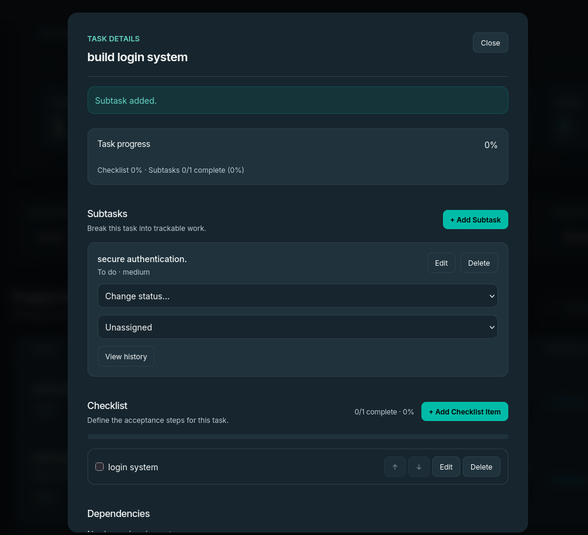
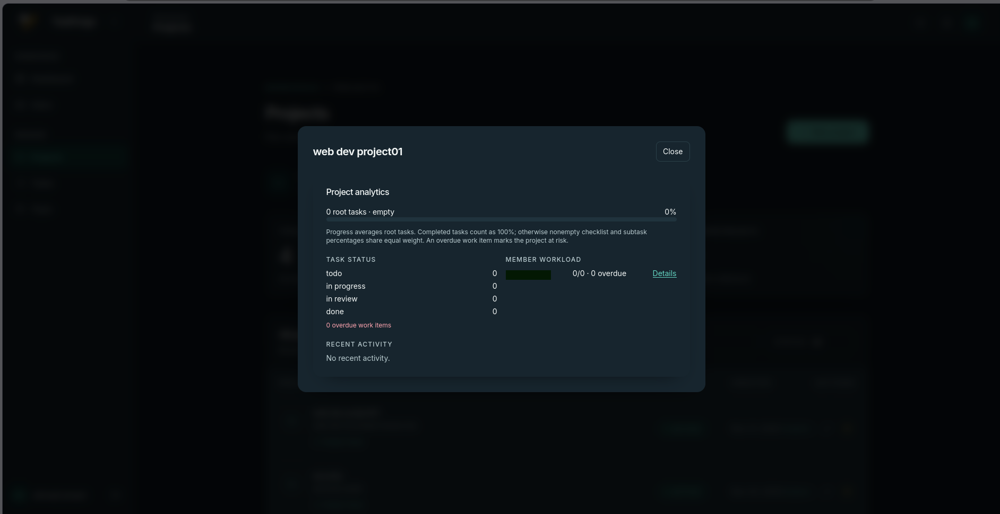
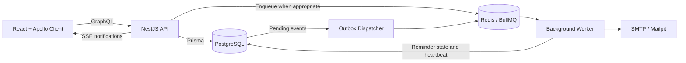

<div align="center">


# TaskForge

**A multi-tenant project and task management platform.**

Manage teams, organize projects, track work, and monitor progress
through a unified workspace.


[Features](#features) ·
[Architecture](#system-architecture) ·
[Performance](#performance) ·
[Getting Started](#getting-started) ·
[Documentation](#documentation)

</div>

---

## Overview

TaskForge is a full-stack workspace platform for organizations
to manage projects, teams, and task lifecycles.

The application combines tenant-scoped authorization, structured
task workflows, real-time notification updates, reliable
background processing, and operational observability.

## Features

| Area | Capabilities |
| --- | --- |
| Workspace management | Organization registration, invitations, member management |
| Access control | ADMIN, MANAGER, EMPLOYEE roles and project-level permissions |
| Project management | Project teams, assignments, archival and progress |
| Task management | Tasks, subtasks, checklists, priorities, deadlines and comments |
| Review workflow | Task submission, approval and change requests |
| Dependencies | Task blockers, cycle prevention and dependency validation |
| Analytics | Project health, employee workload and completion metrics |
| Notifications | Live SSE updates, unread state and deadline reminders |
| Activity history | Task activity records and soft deletion |
| User experience | Responsive workspace, light and dark themes |

## Screenshots

### Landing Page



### Workspace Dashboard



### Light Theme


### Project and Task Management





### Task Details and Analytics





### Additional Views

| View | Screenshot |
| --- | --- |
| Members | [View screenshot](docs/screenshots/members.webp) |
| Notifications | [View screenshot](docs/screenshots/inbox.webp) |
| Mobile workspace | [View screenshot](docs/screenshots/mobile-dashboard.webp) |

## Engineering Highlights

- Multi-tenant authorization reinforced by composite foreign keys.
- JWT authentication with hashed, rotating refresh tokens.
- Transactional outbox for reliable event publication.
- Redis-backed BullMQ queues and a dedicated background worker.
- Concurrency-safe task reviews and dependency graph modifications.
- Cursor pagination and targeted database indexes.
- Structured logs, request correlation and protected metrics.
- Isolated Docker staging for integration and recovery verification.

## System Architecture



TaskForge follows a modular monolith architecture with a separate
background worker.

PostgreSQL is the authoritative data store. Redis supports
asynchronous job processing rather than replacing persistent
business data.

See the [architecture guide](docs/architecture.md).

## Technology Stack

| Layer | Technology |
| --- | --- |
| Frontend | React, TypeScript, Vite, Tailwind CSS |
| Client state and API | Apollo Client |
| Backend | NestJS, GraphQL, Apollo Server |
| ORM | Prisma |
| Database | PostgreSQL |
| Queue | Redis, BullMQ |
| Notifications | Server-Sent Events |
| Email | SMTP, Mailpit for staging |
| Authentication | JWT, bcrypt, refresh-token rotation |
| Testing | Vitest |
| Infrastructure | Docker, Docker Compose |
| CI | GitHub Actions |

## Repository Structure

```text
work-bench/
├── backend/
│   ├── src/
│   ├── prisma/
│   ├── scripts/
│   └── artifacts/
├── frontend/
│   ├── src/
│   └── public/
├── staging/
├── docs/
├── .github/workflows/
└── docker-compose.yml
```

## Database Architecture

The PostgreSQL schema contains 15 models and 7 enums.

Composite foreign keys, unique constraints, indexes and
application-level authorization reinforce data integrity.

See the [database architecture and ER diagram](docs/database.md).

## Authentication and access

Registration creates a user and an organization with an ADMIN membership. Only ADMIN can invite MANAGER and EMPLOYEE organization members. An ADMIN appoints a project manager by adding that MANAGER to the Project Team; this MVP has no separate primary-manager field. A MANAGER can add or remove existing organization EMPLOYEEs on an authorized project's team and assign tasks only to those project employees. ADMIN can manage project teams and assign tasks to project members of any organization role. EMPLOYEEs cannot invite members, manage project teams, create tasks, or assign tasks; they can advance their own assigned tasks and complete assigned checklist items. Removing a project member with assigned tasks requires reassignment first.

Passwords are hashed, access uses JWTs, and refresh tokens are stored as hashes and rotated. Protected GraphQL operations check the caller's organization membership; non-admin project and task access also checks project membership. The backend enforces these rules independently of UI controls.

Every project, task, subtask, checklist item, comment, notification, and activity record is scoped to an organization. Service queries apply organization and, where required, project access checks. Database constraints reinforce subtask organization/project consistency and a single subtask level.

Assigned employees can move work from TODO to IN_PROGRESS and submit it as IN_REVIEW. An ADMIN or project-authorized MANAGER approves submitted work as DONE or returns it to IN_PROGRESS for changes. Review decisions create activity records and notify the assignee. Status writes use a conditional update so competing review decisions cannot both succeed.

## Progress and analytics

A DONE task is 100% complete. Otherwise, progress averages the completion percentages of its nonempty checklist and direct subtasks; a task with neither is 0%. Project progress averages its nondeleted root tasks. Project analytics includes status distribution, overdue work, member workload, recent activity, and health. Employee analytics counts assigned/completed work and completion timing when due date history permits it. Dashboard counts root tasks rather than double-counting subtasks.

## Database and background work

Prisma models users, hashed refresh tokens, organizations/members/invitations, projects/members, tasks/subtasks/checklists/activity/comments, notifications, reminders, and outbox events. SQL migrations live in `backend/prisma/migrations/` and must be applied in order. Soft deletion retains task audit history.

Task mutations write outbox events in the same PostgreSQL transaction as task changes. The dispatcher reads pending events and enqueues BullMQ jobs; this avoids reporting a successful task change while silently losing its event during an API failure. Redis carries the queue, while the separate worker processes task events and SMTP email jobs. Reminder scheduling records notification and email state and uses idempotency/claim checks to reduce duplicate sends.

## Observability

The API and worker write newline-delimited structured JSON logs to stdout/stderr.
Every record contains a timestamp, severity, process, component, and event name.
HTTP and GraphQL logs also include a validated or generated `x-request-id`; the
same ID is returned in the response header. Log serialization redacts secret
keys and common credential formats and never records GraphQL variables or job
payloads.

`GET /metrics` exports Prometheus-compatible, in-process HTTP and GraphQL
request/error/duration metrics, bounded-window p50/p95 values, BullMQ queue
state and Redis connectivity, plus a single pending-outbox aggregate. The
endpoint requires `Authorization: Bearer <METRICS_ACCESS_TOKEN>` and remains
closed when the token is absent. Labels are deliberately limited to HTTP
method, normalized route, status class, GraphQL operation type, and queue
state. The p50/p95 gauges use the nearest-rank values from the latest 1,024
durations for each label set, reset on process restart, and are not
mergeable across API replicas. Long-lived notification SSE connections are
counted as HTTP requests but excluded from HTTP latency histograms and p50/p95.
Queue/outbox snapshots are cached for five seconds per API process and
concurrent scrapes share one collection attempt. Health endpoints remain
separate: `/health/live` checks only the API
process, `/health/ready` checks PostgreSQL and Redis, and `/health/worker`
reports the worker heartbeat without infrastructure details.

## Performance

Historical Prisma Client benchmark results recorded on
October 20, 2026:

| Operation | Median | p95 |
| --- | ---: | ---: |
| Task listing | 1.751 ms | 2.706 ms |
| Task search and pagination | 0.573 ms | 0.765 ms |
| Task count | 0.306 ms | 0.388 ms |
| Comment cursor - middle | 0.466 ms | 0.483 ms |

Benchmark configuration: PostgreSQL 18.6, 100 project tasks,
101 comments on the selected task, 5 warm-up runs and
50 measured runs per workload.

These are historical client-side database query measurements,
not production API latency or concurrent-user capacity.

See the [performance engineering report](docs/performance.md).

## Getting Started

For isolated local verification, prefer the [staging setup](staging/README.md).

### Manual development setup

Prerequisites: Node.js 22, pnpm 10.34.5, PostgreSQL, Redis, and an SMTP sink such as Mailpit. Use only local development credentials. Create your own `backend/.env` from `backend/.env.example`; never commit it. Set the API database URLs and Redis/SMTP connection details, verify that both database URLs point to your local development database, then run:

```bash
cd backend
pnpm install --frozen-lockfile
pnpm exec prisma generate
pnpm exec prisma migrate deploy
pnpm start:dev
```

In separate terminals, run the worker and frontend:

```bash
cd backend && pnpm start:worker:dev
cd frontend && pnpm install --frozen-lockfile && pnpm dev
```

Set the frontend `VITE_GRAPHQL_URL` to the local GraphQL endpoint if the default `http://localhost:3000/graphql` is unsuitable. The worker uses the same backend environment. The root `docker-compose.yml` is a separate development stack; review its port and credential defaults before starting it. For the tested isolated Docker setup, follow [staging/README.md](staging/README.md). Its generated state and three data volumes are separate from the root stack, and its API, UI, and Mailpit ports bind only to loopback.

## Environment Variables

Configure these in your own ignored environment file or deployment secret store. This table intentionally contains no credential values.

| Variable                                                                    | Purpose                                                                 |
| --------------------------------------------------------------------------- | ----------------------------------------------------------------------- |
| `DATABASE_URL`, `DATABASE_URL_UNPOOLED`                                     | Prisma PostgreSQL connections                                           |
| `JWT_ACCESS_SECRET`, `JWT_ACCESS_EXPIRES_IN`                                | JWT signing and access lifetime                                         |
| `REFRESH_TOKEN_TTL_DAYS`                                                    | Refresh lifetime                                                        |
| `METRICS_ACCESS_TOKEN`                                                      | Separate bearer token protecting `GET /metrics`; required in production |
| `NODE_ENV`, `PORT`                                                          | Runtime mode and API port                                               |
| `CORS_ORIGINS`, `FRONTEND_URL`                                              | Browser origins and invitation link base                                |
| `REDIS_HOST`, `REDIS_PORT`, `REDIS_USERNAME`, `REDIS_PASSWORD`, `REDIS_TLS` | Queue connection                                                        |
| `SMTP_HOST`, `SMTP_PORT`, `SMTP_USER`, `SMTP_PASS`, `SMTP_FROM`             | Email delivery                                                          |
| `TRUST_PROXY`                                                               | Trusted reverse proxy addresses, when applicable                        |
| `VITE_GRAPHQL_URL`                                                          | GraphQL URL compiled into the frontend                                  |

See `backend/.env.example` for variable descriptions. Never reuse local/staging secrets for a deployed environment.

## Testing and CI

GitHub Actions runs on pushes to `main` and the active `dev`, `develop`,
`development`, `feature/**`, `fix/**`, `test/**`, and `ui/**` branch families,
and on pull requests targeting `main`. Superseded runs for the same branch or
pull request are cancelled.

- Backend: frozen-lockfile install with pnpm caching, Prisma Client generation,
  lint, unit and self-contained integration tests, and a type-checked Nest
  production build.
- Frontend: frozen-lockfile install with pnpm caching, lint, TypeScript
  checking, tests, and a production build.
- Backend integration: migrations and the refresh-token and reminder queue
  integration tests run against disposable PostgreSQL and Redis service
  containers created for the workflow. They never use deployment databases.

The real SMTP integration test and full browser/functional staging workflows
remain guarded local release checks because they require Mailpit and the
isolated multi-service staging stack.

### Local verification

```bash
(cd backend && pnpm exec prisma generate)
(cd backend && pnpm lint && pnpm build)
(cd backend && pnpm exec vitest run --exclude 'src/auth/token.service.integration.spec.ts' --exclude 'src/task-reminders/task-reminder.integration.spec.ts')
(cd frontend && pnpm exec tsc -b --pretty false && pnpm lint && pnpm test && pnpm build)
```

For integration and functional verification, follow the
[isolated staging guide](staging/README.md).

A complete desktop/mobile browser verification pass remains
part of the release checklist.

## Documentation

| Document | Description |
| --- | --- |
| [Architecture](docs/architecture.md) | System design and data flow |
| [Database](docs/database.md) | ER diagram, relationships and constraints |
| [Engineering Decisions](docs/engineering-decisions.md) | Architectural rationale and trade-offs |
| [Performance](docs/performance.md) | Benchmarks and optimization strategies |
| [Security Policy](SECURITY.md) | Security controls and vulnerability reporting |
| [Deployment](docs/deployment.md) | Secure deployment and operational guidance |
| [Testing](docs/testing.md) | Test strategy, CI and release verification |
| [Changelog](CHANGELOG.md) | Development milestones and release history |
| [Staging](staging/README.md) | Isolated local verification |
| [Backend](backend/README.md) | Backend development guide |
| [Frontend](frontend/README.md) | Frontend development guide |

## Security Considerations

Keep all `.env` files and `staging/.state/` out of Git and Docker build contexts. Treat invitation links, JWTs, and refresh tokens as secrets. Use HTTPS, restrictive CORS, trusted proxy settings, durable PostgreSQL/Redis, and an SMTP provider in a deployment. The local staging environment verifies behavior on an empty database; test migrations on sanitized representative data before any production rollout.

## Known Limitations and Future Improvements

- Add browser automation for desktop/mobile interaction and accessibility checks.
- Add representative-data migration tests.
- Complete production deployment and environment-specific operational verification.
- Evaluate server-side session-family revocation for stronger logout guarantees.

## Author

- [GitHub](https://github.com/mahmadnsr)
- [LinkedIn](https://www.linkedin.com/in/md-ahmad-ansari/)
