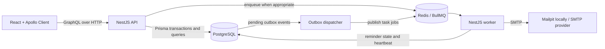

# TaskForge architecture

TaskForge is a React single-page application backed by a NestJS GraphQL API and a separate NestJS worker. PostgreSQL holds authoritative business data through Prisma. Redis holds BullMQ jobs. SMTP delivers invitations and reminder email; isolated staging sends to Mailpit.

## Frontend and API

The Vite/TypeScript frontend uses Apollo Client for GraphQL operations and React Router for page navigation. Dashboard, Projects, Tasks, Members, Inbox, Login/Register, and invitation acceptance are separate views. `VITE_GRAPHQL_URL` selects the API endpoint at build time. GraphQL resolvers map user requests to NestJS services; the services apply access checks before Prisma queries or mutations. Health endpoints report API dependencies and worker heartbeat.

## PostgreSQL and tenant boundaries

Prisma models organization membership separately from project membership. Organizations contain projects; tasks belong to both an organization and project, and may have one parent task. Checklist items, comments, activity, notifications, reminders, and outbox records reference their owning work. The backend scopes lookups by organization ID and checks project membership for non-admin access. SQL constraints enforce one-level subtask hierarchy and organization/project consistency. Task deletion is soft; activity is retained for audit, while normal task and notification reads exclude deleted tasks.

## Authentication and authorization

Registration creates the first ADMIN user and organization. Invitation tokens are validated against recipient email and consumption state. Passwords are hashed. Login issues a short-lived JWT and a refresh token; only the refresh token hash is stored in PostgreSQL. Refresh rotates it, and logout revokes it. GraphQL guards require authentication and rate-limit operations. Service-level role checks distinguish ADMIN, MANAGER, and EMPLOYEE actions. UI controls reflect permissions but do not grant them.

## Background processing and email

Task create/assign/status changes write outbox records in the same transaction as their data change. The outbox dispatcher reads those records and publishes idempotent task-event jobs to BullMQ. Redis is queue transport, not the primary database. A separate worker consumes queue jobs, sends SMTP email, scans due-date reminders, and records a heartbeat. Reminder records and claim checks protect delivery from duplicate processing; an uncertain SMTP outcome is recorded for review rather than blindly retried. Staging directs email to Mailpit.

## Progress and analytics

For an unfinished task, the API averages each nonempty component: checklist completion percentage and direct-subtask DONE percentage. DONE tasks report 100%; tasks with no components report 0%. Project progress averages nondeleted root tasks. Project analytics adds status counts, overdue work, member workload, recent activity, and a health label. Employee analytics counts assigned/completed/pending/in-progress/overdue work and completion timing where history permits it. Dashboard summaries count root tasks, with project membership filtering for non-admin users.

## Local verification

See the root [README](../README.md) for setup and tests, and [isolated staging instructions](../staging/README.md) for local Docker validation. Staging checks the live GraphQL schema against frontend documents, exercises cross-organization and cross-project denial, and tests invitation, task, analytics, and notification flows.
