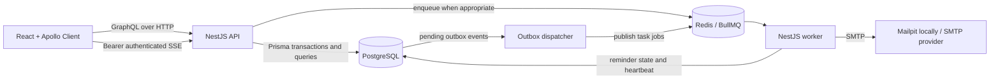

# TaskForge architecture

TaskForge is a React single-page application backed by a NestJS GraphQL API and a separate NestJS worker. PostgreSQL holds authoritative business data through Prisma. Redis holds BullMQ jobs. SMTP delivers invitations and reminder email; isolated staging sends to Mailpit.

## Frontend and API

The Vite/TypeScript frontend uses Apollo Client for GraphQL operations and React Router for page navigation. Dashboard, Projects, Tasks, Members, Inbox, Login/Register, and invitation acceptance are separate views. `VITE_GRAPHQL_URL` selects the API endpoint at build time. GraphQL resolvers map user requests to NestJS services; the services apply access checks before Prisma queries or mutations. Health endpoints report API dependencies and worker heartbeat.

## PostgreSQL and tenant boundaries

Prisma models organization membership separately from project membership. Organizations contain projects; tasks belong to both an organization and project, and may have one parent task. Project Team uses existing project membership: adding a MANAGER appoints that manager to the project for this MVP, without a separate primary-manager field. Task assignment points to a project member and does not create membership. Checklist items, comments, activity, notifications, and reminders reference their owning work through database relationships. Outbox events carry business references in their JSON payload without direct foreign keys. The backend scopes lookups by organization ID and checks project membership for non-admin access. SQL constraints enforce one-level subtask hierarchy and organization/project consistency. Task deletion is soft; activity is retained for audit, while normal task and notification reads exclude deleted tasks.

## Authentication and authorization

Registration creates the first ADMIN user and organization. Only ADMIN can invite organization members and choose their roles. ADMIN can manage any project team; a MANAGER can add or remove existing organization EMPLOYEEs only on projects they manage. MANAGER task assignees must be EMPLOYEE project members, while ADMIN can assign any project member. EMPLOYEEs cannot manage teams or task ownership. Invitation tokens are validated against recipient email and consumption state. Passwords are hashed. Login issues a short-lived JWT and a refresh token; only the refresh token hash is stored in PostgreSQL. Refresh rotates it, and logout revokes it. GraphQL guards require authentication and rate-limit operations. UI controls reflect permissions but do not grant them.

## Task dependencies and live notifications

Notification rows are written in PostgreSQL with task changes. A bearer-authenticated SSE endpoint polls those persisted rows for the current recipient, applying organization and project visibility on every poll. It sends change signals without message contents; Apollo refetches the inbox and unread count. This works across API instances without Redis pub/sub, and a periodic sync reconciles reconnect and transaction-timestamp races. The browser keeps the access token in a header, reconnects with backoff, refreshes expired access tokens, and aborts streams on logout.

Task dependencies are directed edges between nondeleted tasks in one project. Composite foreign keys enforce organization and project equality for both ends. ADMIN and project MANAGER mutations take a PostgreSQL project-row lock before reading the graph and checking cycles; status transitions use the same lock before checking incomplete blockers. Linked tasks cannot be soft-deleted until their edges are removed. Dependencies do not change the existing progress formula.

## Background processing and email

Task create/assign/status changes write outbox records in the same transaction as their data change. The outbox dispatcher reads those records and publishes idempotent task-event jobs to BullMQ. Redis is queue transport, not the primary database. A separate worker consumes queue jobs, sends SMTP email, scans due-date reminders, and records a heartbeat. Reminder records and claim checks protect delivery from duplicate processing; an uncertain SMTP outcome is recorded for review rather than blindly retried. Staging directs email to Mailpit.

## Progress and analytics

For an unfinished task, the API averages each nonempty component: checklist completion percentage and direct-subtask DONE percentage. DONE tasks report 100%; tasks with no components report 0%. Project progress averages nondeleted root tasks. Project analytics adds status counts, overdue work, member workload, recent activity, and a health label. Employee analytics counts assigned/completed/pending/in-progress/overdue work and completion timing where history permits it. Dashboard summaries count root tasks, with project membership filtering for non-admin users.

## Local verification

See the root [README](../README.md) for setup and tests, and [isolated staging instructions](../staging/README.md) for local Docker validation. Staging checks the live GraphQL schema against frontend documents, exercises cross-organization and cross-project denial, and tests invitation, task, analytics, and notification flows.
