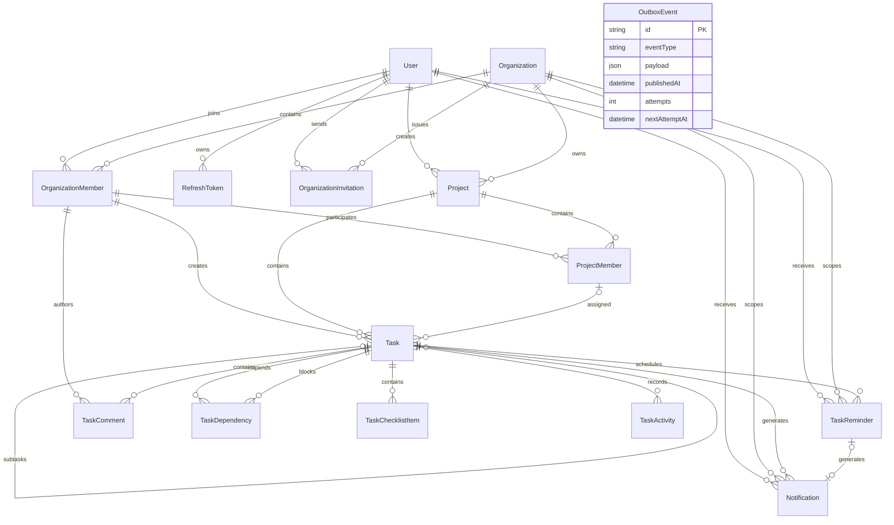
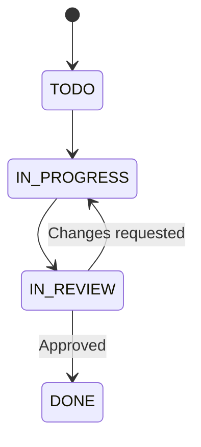

# Database Architecture

TaskForge uses PostgreSQL with Prisma ORM. The database contains
15 models and 7 enums, supporting multi-tenancy, authentication,
project management, task workflows, notifications, and reliable
background processing.

## Entity Relationship Diagram

## Model Organization

| Domain | Models |
| --- | --- |
| Identity | User, RefreshToken |
| Multi-tenancy | Organization, OrganizationMember, OrganizationInvitation |
| Projects | Project, ProjectMember |
| Tasks | Task, TaskDependency, TaskChecklistItem, TaskActivity, TaskComment |
| Background processing | Notification, OutboxEvent, TaskReminder |

## Tenant Isolation

OrganizationMember connects users to organizations and stores
organization-specific roles.

ProjectMember connects organization members to projects.
Composite foreign keys enforce organization consistency.

Tasks reference their owning project and organization.
Subtask and dependency relationships enforce matching
organization and project identifiers.

Application-level authorization complements database constraints.
Database relationships alone do not replace authorization checks.

## Task Lifecycle

This diagram represents the standard employee submission
and managerial review workflow.

## Database Integrity

- Unique organization membership per user and organization.
- Unique project membership per user and project.
- Task assignment references an existing project member.
- Composite foreign keys enforce subtask and dependency scope.
- Composite primary key prevents duplicate dependency edges.
- Unique reminder identity prevents duplicate reminder records.
- Task soft deletion preserves activity history.
- Restrictive foreign keys protect referenced records.

## Indexing Strategy

Indexes support common access patterns:

- Organization and project filtering.
- Task status, priority, assignee, and deadline queries.
- Task listing and activity history pagination.
- Notification retrieval and unread counts.
- Refresh-token expiration queries.
- Pending outbox event processing.
- Reminder scheduling and processing.

## Transactional Outbox

OutboxEvent stores durable event records with publication,
retry, and locking metadata.

Business changes and corresponding outbox events are written
within the same PostgreSQL transaction.

The dispatcher publishes pending events to BullMQ, allowing
background processing to recover from temporary failures.

OutboxEvent has no direct foreign-key relationship to business
entities in the Prisma schema. Event-specific references are
carried in its JSON payload.

## Security Considerations

- Passwords and refresh tokens are stored as hashes.
- Invitation tokens are stored as hashes.
- Database credentials are supplied through environment variables.
- Backend services enforce tenant and project authorization.
- Soft deletion and restrictive relationships protect task history.

## Engineering Trade-offs

- Composite foreign keys improve data integrity but increase
  schema and migration complexity.
- Soft deletion preserves history but requires consistent
  filtering in application queries.
- Additional indexes improve targeted reads but consume storage
  and introduce write overhead.
- Transactional outbox improves event reliability but introduces
  asynchronous processing and eventual consistency.

## Source of Truth

- [Prisma schema](../backend/prisma/schema.prisma)
- [SQL migrations](../backend/prisma/migrations/)
- [System architecture](architecture.md)

Migration-level constraints and application-level authorization
must be reviewed alongside the Prisma schema.
