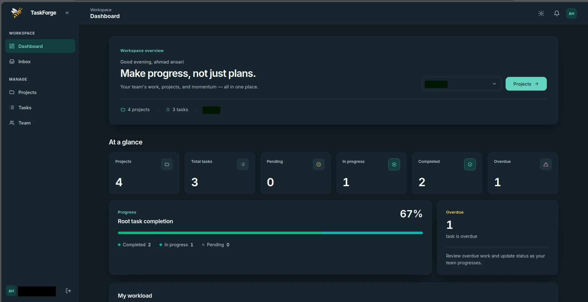
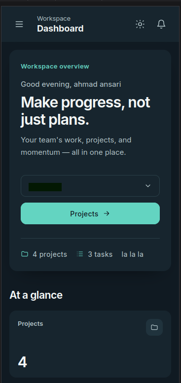

# TaskForge — Frontend

The TaskForge frontend is a responsive project management workspace
built with React, TypeScript, Vite and Apollo Client.

It provides role-aware navigation, project and task management,
organization administration, analytics and real-time notifications.

## Technology Stack

| Technology | Purpose |
| --- | --- |
| React | Component-based user interface |
| TypeScript | Type-safe frontend development |
| Vite | Development server and production builds |
| Apollo Client | GraphQL communication and caching |
| React Router | Client-side routing |
| Tailwind CSS | Utility-based styling |
| Vitest | Automated testing |
| React Testing Library | Component and interaction testing |
| ESLint | Static code analysis |

## Application Features

- Responsive landing page and authenticated workspace.
- Persistent light and dark theme preferences.
- Organization and project management.
- Task creation, assignment and status workflows.
- Subtasks, checklists and task dependencies.
- Task review and approval workflows.
- Project progress and employee analytics.
- Real-time notification inbox.
- Organization membership and role management.
- Authentication and invitation acceptance.

## Source Structure

    src/
    ├── assets/       Branding and static assets
    ├── auth/         Authentication state and session lifecycle
    ├── components/   Reusable UI components
    ├── hooks/        Reusable React hooks
    ├── layouts/      Shared application layouts
    ├── lib/          Apollo Client and authentication utilities
    ├── pages/        Application screens and workflows
    └── utils/        Shared utility functions

## Authentication and Session Management

The frontend uses a shared authentication state and coordinated
refresh-token handling.

Session management includes:

- Single-flight token refresh coordination.
- Protection against stale authentication responses.
- Coordinated logout and refresh behavior.
- Controlled retries for authenticated read operations.
- No automatic replay of failed GraphQL mutations.
- Session-expiration feedback.
- Notification stream reconnection.

Frontend access controls improve the user experience, but the
backend remains responsible for enforcing authorization.

See the [security policy](../SECURITY.md) for known session limitations.

## Real-Time Notifications

The frontend receives notification signals through Server-Sent Events
and refreshes relevant GraphQL data.

Persisted backend notifications remain the authoritative data source.
Reconnection and periodic synchronization help recover from temporary
connection failures.

## Local Development

From the frontend directory:

### Install dependencies

    pnpm install --frozen-lockfile

### Configure the GraphQL endpoint

Create a local environment file containing:

    VITE_GRAPHQL_URL=http://localhost:3000/graphql

This assumes the local development API is available on port 3000.

Vite environment variables are exposed to the browser.
Never place credentials or private API keys in VITE-prefixed variables.

### Start the development server

    pnpm dev

For the integrated application environment, follow the
[isolated staging guide](../staging/README.md).

## Validation and Testing

### TypeScript verification

    pnpm exec tsc -b --pretty false

### Static analysis

    pnpm lint

### Automated tests

    pnpm test

### Production build

    pnpm build

### Preview the production build

    pnpm preview

The preview command is intended for local verification, not as
a production web server.

See the [testing guide](../docs/testing.md) for the complete
release verification strategy.

## User Interface

The workspace uses a shared responsive layout, theme-aware components
and consistent navigation across authenticated application screens.

### Dashboard

### Light Theme

### Mobile Workspace

## Further Documentation

- [Project overview](../README.md)
- [System architecture](../docs/architecture.md)
- [Engineering decisions](../docs/engineering-decisions.md)
- [Security policy](../SECURITY.md)
- [Deployment guide](../docs/deployment.md)

## Framework Attribution

Built with [React](https://react.dev/) and [Vite](https://vite.dev/).
